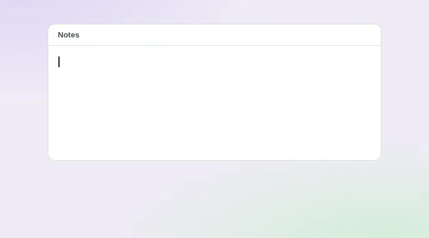
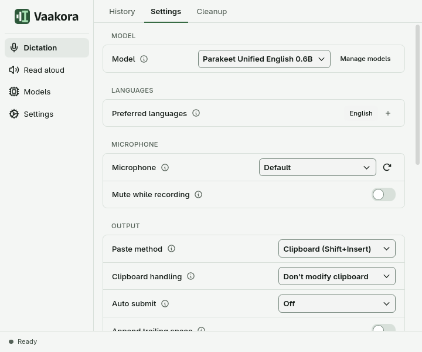
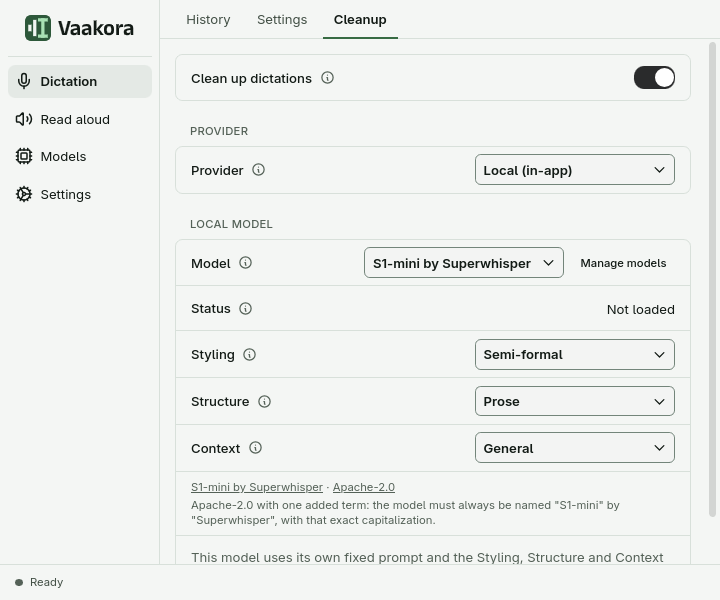
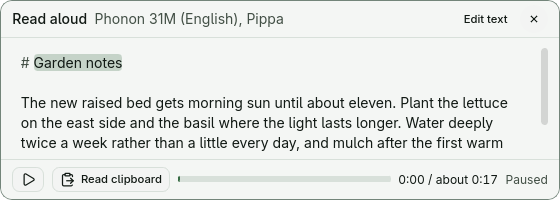
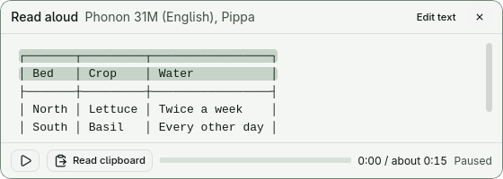
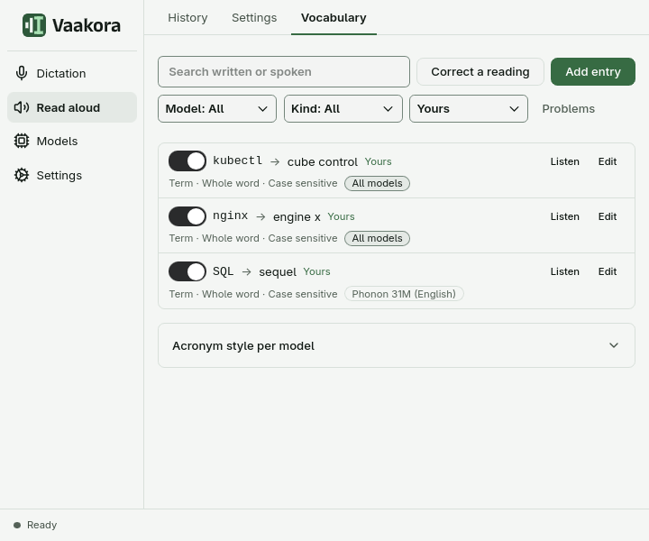
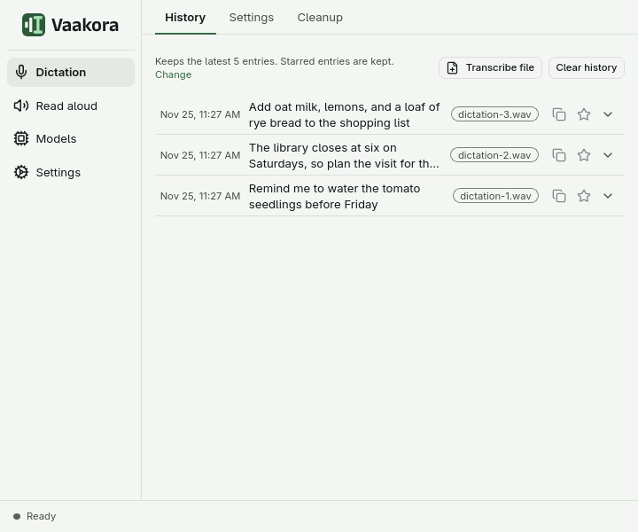
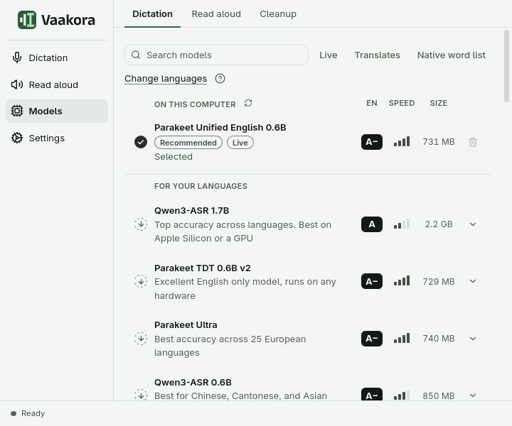
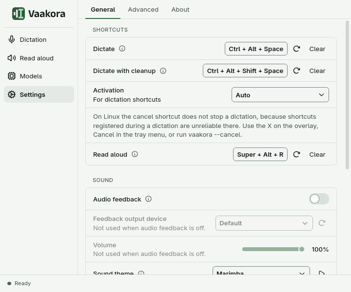

<h1 align="center">
  <picture>
    <source media="(prefers-color-scheme: dark)" srcset="docs/assets/brand/mark-dark.svg" />
    
  </picture>
  <picture>
    <source media="(prefers-color-scheme: dark)" srcset="docs/assets/brand/wordmark-dark.svg" />
    
  </picture>
</h1>

<p align="center"><strong>Speak to type. Listen to read. All on your own computer.</strong></p>

<p align="center">
  <a href="LICENSE"></a>
  <a href="#platform-support"></a>
  <a href="#at-a-glance"></a>
</p>

<p align="center">
  
</p>

**Local dictation, transcript cleanup and read aloud for Linux. Everything runs on your own computer.**

## At a glance

- **Dictation:** press a shortcut, speak, and your words appear in any text field.
- **Local cleanup:** a small language model can tidy the transcript.
- **Read aloud:** another shortcut reads the text you copied back to you.
- **Command line and agents:** a `vaakora` command controls the running app, and optional skills let Claude Code and Codex read aloud when you ask.
- **Private by default:** audio and text stay on the machine.
- **Linux desktop app:** used daily on Fedora 45 (KDE Plasma, Wayland); the distributions under Install are install-tested.

The [docs](https://vaakora.jugraj.dev/) have a page per feature.

## What it does

### Dictation

Press a configurable shortcut, speak, and the transcript is pasted into the app you are using.

<picture>
  <source media="(prefers-color-scheme: dark)" srcset="docs/assets/screens/dictation-dark.webp" />
  
</picture>

- **Shortcut:** hold it to record and release to stop, or tap it to toggle recording on and off.
- **Silence:** filtered with Silero voice activity detection.
- **Models:** transcription runs locally with Whisper models (with GPU acceleration when available) or Parakeet V3.
- **Custom words:** offline Parakeet models with a TDT or RNN-T decoder take your custom words as they recognise speech. Live (streaming) models never get them and keep correcting them afterwards.
- **Shortcut changes:** applied atomically, and a usable dictation shortcut is always kept.
- **Paste helpers:** the programs that paste dictated text run under a deadline, so a hung helper cannot hold up dictation.

### Local post-processing

A "Local (in-app)" post-processing provider cleans up a transcript with a small language model that runs on the CPU.

<picture>
  <source media="(prefers-color-scheme: dark)" srcset="docs/assets/screens/cleanup-local-dark.webp" />
  
</picture>

- Runs through a bundled `llama-server`. Nothing has to be installed or started separately.
- Transcripts never leave the machine.
- Five downloadable models are offered, each pinned to a fixed revision, size and SHA-256.
- History keeps which model produced each cleaned-up entry and compares it with the raw text.
- The **Dictate with cleanup** shortcut sits next to the **Dictate** shortcut, which records without cleanup.

### Read aloud

A shortcut reads the text you last copied, in a popup that follows along.

<picture>
  <source media="(prefers-color-scheme: dark)" srcset="docs/assets/screens/read-aloud-dark.webp" />
  
</picture>

- **Shortcut:** Super+Alt+R by default.
- **Follow-along popup:** highlights the sentence being read.
- **Streaming and controls:** reading is streamed and has speed and pitch controls.
- **Markdown:** marks are not spoken.
  - Code blocks are skipped unless you ask for them.
  - A code block that holds only a table is read as a table.
- **Tables:** box-drawing, ASCII and Markdown tables are read row by row, each value with its column name (a setting reads the column names once instead), and their borders are not spoken.
  - Box-drawing characters are never spoken anywhere.
  - A table that cannot be read with confidence is read in its original order without its borders.
  - The reader shows box-drawing and ASCII tables in a monospaced font so their walls line up.
- **Technical reading:** paths, file names, flags, versions and code names are spoken the way an engineer would say them.
- **Vocabulary:** extend the spoken forms in `tts-vocabulary.json` in the app data directory. It also accepts entries for one voice model only.
- **No overlap:** dictation and reading never overlap.

- **Voice models:** eight downloadable voice models are offered, in the six rows below. The Indic Tiny TTS row covers three of them: Indian English, Hindi and Punjabi.
- **Devices:** GPU and NPU mean an Intel GPU or NPU through OpenVINO.

| Voice model                                     | Runs on                              |
| ----------------------------------------------- | ------------------------------------ |
| Pocket TTS                                      | CPU, GPU and NPU in part (see below) |
| Supertonic 3                                    | CPU, GPU, NPU                        |
| Kokoro-82M                                      | CPU, GPU, NPU                        |
| Paradee-8M                                      | CPU                                  |
| Phonon 31M (English)                            | CPU                                  |
| Indic Tiny TTS (Indian English, Hindi, Punjabi) | CPU, GPU                             |

- The app picks the best device that works on the machine.
- Pocket TTS keeps part of its work on the CPU (ONNX Runtime). On the GPU only its text conditioner runs there, and its main flow model, flow sampler and audio decoder stay on the CPU. On the NPU its main flow model stays on the CPU.

#### Tables

<picture>
  <source media="(prefers-color-scheme: dark)" srcset="docs/assets/screens/tables-reader-dark.webp" />
  
</picture>

- Tables in the text you copy are read row by row, each value with its column name, and their borders are not spoken.
- Choose Name each value or Names once, then rows with the **Tables** setting in Read aloud, Settings. The [Tables page](https://vaakora.jugraj.dev/tables.html) has an example of each.

### Vocabulary

<picture>
  <source media="(prefers-color-scheme: dark)" srcset="docs/assets/screens/vocabulary-dark.webp" />
  
</picture>

- Change how a word is spoken in Read aloud: correct a reading or add an entry, for all voice models or for one.
- Entries are kept in `tts-vocabulary.json` in the app data directory. See the [Vocabulary page](https://vaakora.jugraj.dev/vocabulary.html).

### History

<picture>
  <source media="(prefers-color-scheme: dark)" srcset="docs/assets/screens/history-dictation-dark.webp" />
  
</picture>

- Dictation history keeps your recordings. A cleaned-up entry says which model produced it and can be compared with the raw text. Clear history removes all unstarred entries and their recordings, and asks first.
- Read aloud history is text only: the app never keeps audio for a read.
- Both histories are kept on this computer. See the [History page](https://vaakora.jugraj.dev/history.html).

### Models

<picture>
  <source media="(prefers-color-scheme: dark)" srcset="docs/assets/screens/models-dark.webp" />
  
</picture>

- Models has three tabs: Dictation, Read aloud and Cleanup. Download a model, choose it, and see its size and licence.
- Models are downloaded on demand and run on your own computer. See the [Models page](https://vaakora.jugraj.dev/models.html).

### Settings

<picture>
  <source media="(prefers-color-scheme: dark)" srcset="docs/assets/screens/settings-dark.webp" />
  
</picture>

- General holds the shortcuts and the sound options. The three shortcuts are **Dictate**, **Dictate with cleanup** and **Read aloud**, each with Reset and Clear buttons.
- **Activation** is a drop-down for the dictation shortcuts, with the options Auto (hold to record or tap to toggle), Hold (records while you hold the shortcut) and Toggle (tap to start recording, tap again to stop). Auto is the default.
- A shortcut already assigned to another action is refused with a message naming that action. See the [Settings page](https://vaakora.jugraj.dev/settings.html).

The full list of changes is in [CHANGELOG.md](CHANGELOG.md). Its new interface strings are translated into the other 26 languages by machine and have not been reviewed by native speakers.

## Command line and agents

The `vaakora` command also drives the running app from a terminal, a script or a coding agent. It needs the app to be running: it never starts it, and exits with 3 when there is nothing to talk to.

- `vaakora read [file|-]` reads a file aloud, or text piped in on standard input (`-` or no file). The text is never taken from an argument, because other programs on the machine could see it.
- `vaakora pause`, `vaakora resume` and `vaakora stop` control the reader.
- `vaakora status` and `vaakora voices` report what the app is doing and which voices are downloaded. Add `--json` for JSON.
- `vaakora dictate [--post-process|--cancel]` toggles a dictation, with or without post-processing, or cancels it.
- `vaakora transcribe <file> [--json]` prints the transcript of an audio file. The file is added to History, as Transcribe a file does there.

Reads that come from the command line or an agent are saved in Read aloud history with a small "from agent" tag. A read you start with the shortcut is not tagged.

Exit codes, for scripts:

| Code | Meaning                                                                                                                                                                          |
| ---- | -------------------------------------------------------------------------------------------------------------------------------------------------------------------------------- |
| 0    | Done. `pause`, `resume` and `stop` also exit 0 when there was nothing to change, and say so on stderr.                                                                           |
| 1    | The app answered with an error, such as a `transcribe` file it cannot find or decode, or the output could not be written.                                                        |
| 2    | Usage error, found before the app is asked: an unknown option, no file and no piped text, a path that is not a file, or text that is blank, not UTF-8, over 1 MiB or unreadable. |
| 3    | The app cannot be reached: it is not running, there is no runtime directory or the socket path is too long, or it did not answer in time.                                        |
| 4    | A dictation is in progress. The dictation goes on and nothing is read.                                                                                                           |
| 5    | A model is missing: the speech model, or the voice model the reader needs, is not downloaded or ready.                                                                           |

Right after the app starts, `vaakora read` can return exit 5 (`tts-unavailable`) for a moment, while read aloud is still loading. Run it again.

### Agent skills

`vaakora agent install [--claude] [--codex] [--dry-run]` writes two skills, `vaakora-read` and `vaakora-stop`, for Claude Code (`~/.claude/skills`) and Codex (`~/.agents/skills`). Without a flag it installs for both, and `--dry-run` lists what it would write and writes nothing.

- **Explicit only:** the skills never run on their own. In Claude Code you invoke `/vaakora-read <path>` or `/vaakora-stop`, and in Codex `$vaakora-read`. Installing is a command you run; nothing installs a skill for you.
- **Your files are safe:** the command refuses to touch a skill folder it did not write, and `vaakora agent uninstall` removes only the files it wrote.
- **A temporary file:** to read text from the conversation, the skill writes it to a file in `$XDG_RUNTIME_DIR`, never in a repository, and deletes it after `vaakora read` finishes. Claude Code may ask once before it allows that deletion.

### Privacy

- The app listens on `$XDG_RUNTIME_DIR/vaakora.sock` (or `$VAAKORA_SOCKET`). The socket is readable and writable only by you, in a folder only you can open, and the app answers only processes that run as your user.
- Text reaches the app through a file or standard input, never as an argument, and the socket's own logging never holds it.
- The socket is local to the machine. Nothing is sent over a network.

## Moving from Handy

- On its first start, when Vaakora has no data folder yet and Handy's settings file exists, Vaakora copies your settings, both histories, recordings, the vocabulary file, models and web storage. Start at login is turned off in the copy, so only one app starts at login.
- The Handy folder is only read and is never changed. Quit Handy before dictating, because both apps use the same shortcut.
- See the [Moving from Handy page](https://vaakora.jugraj.dev/moving-from-handy.html).

## Install

Download the package for your distribution from the [latest release](https://github.com/jugrajsingh/vaakora/releases/latest) on GitHub Releases, together with `SHA256SUMS`, and check it with `sha256sum -c --ignore-missing SHA256SUMS`.

| Distribution                                           | File                                 | Install                                               |
| ------------------------------------------------------ | ------------------------------------ | ----------------------------------------------------- |
| Fedora 44 and 45                                       | `Vaakora-0.4.0-1.x86_64.rpm`         | `sudo dnf install ./Vaakora-0.4.0-1.x86_64.rpm`       |
| Debian 12 and 13, Ubuntu 22.04, 24.04, 26.04 and 26.10 | `Vaakora_0.4.0_amd64.deb`            | `sudo apt install ./Vaakora_0.4.0_amd64.deb`          |
| Arch Linux                                             | `vaakora-0.4.0-1-x86_64.pkg.tar.zst` | `sudo pacman -U ./vaakora-0.4.0-1-x86_64.pkg.tar.zst` |
| Other distributions                                    | `Vaakora_0.4.0_amd64.AppImage`       | `chmod +x Vaakora_0.4.0_amd64.AppImage`, then run it  |

- The packages are for x86_64 only.
- If the AppImage does not start, install FUSE 2 (`libfuse2`) or run it with `--appimage-extract-and-run`.
- There is no automatic update. To update, install the newer package from Releases the same way.

## Platform support

- Linux x86_64: the Fedora, Debian, Ubuntu and Arch packages above, each install-tested in a clean container; the AppImage was tested the same way on Fedora 45, Debian 12, Ubuntu 22.04 and Arch. Used daily on Fedora 45 (KDE Plasma, Wayland) on an Intel Core Ultra 7 258V.
- The device ratings shown in Models, Read aloud were measured on that one machine. Other hardware may rank devices differently.
- Windows and macOS: coming soon. Local cleanup, read aloud and the command line are not ported yet, so a Windows or macOS build from source runs only the features Vaakora shares with upstream Handy and is untested. People who want to try are welcome and can report what they find.
- There is one maintainer.

## Building

### Build from source

1. Install the prerequisites in [BUILD.md](BUILD.md).
2. Stage the extra build requirements from the "Relationship to upstream" section of [CHANGELOG.md](CHANGELOG.md): a CPU-only `llama-server` built from source, linked statically except for glibc and the GCC C++ runtime, as `llm-bin/`, and the text-to-speech worker with its OpenVINO libraries as `tts-bin/`. The .deb, .rpm and AppImage bundles install them at `/usr/lib/Vaakora/llm` and `/usr/lib/Vaakora/tts` (`bundle.linux.{deb,rpm,appimage}.files` in `tauri.conf.json`), and the Arch package is repacked from the .deb.
3. Install the dependencies:

   ```bash
   bun install
   ```

4. Start the dev server, or build for production:

   ```bash
   bun tauri dev
   bun run tauri build
   ```

### Build the Linux packages

This builds the RPM, `.deb`, Arch package and AppImage from this repository in one step. The details are in [packaging/README.md](packaging/README.md).

1. Commit your changes. The build refuses a dirty tree.
2. Run the build script:

   ```bash
   packaging/build.sh
   ```

3. Find the packages in `packaging/dist/`.

## Built on Handy

Vaakora began as a fork of [Handy](https://github.com/cjpais/Handy) by CJ Pais, used under the MIT licence. Handy's name, logo and brand assets are not part of Vaakora. Vaakora is not affiliated with or endorsed by Handy or its author.

- The transcription engines and models are upstream's.
- Vaakora pins the speech-to-text engine, transcribe.cpp, to a revision past upstream's v0.4.2 that adds phrase boosting.
- Vaakora's other additions are the local post-processing, read aloud, the command line and the dictation changes above.
- [UPSTREAM.md](UPSTREAM.md) records the upstream base and what was decided for each upstream commit since.
- The "Relationship to upstream" section of [CHANGELOG.md](CHANGELOG.md) lists every setting, event, command, dependency and upstream file that Vaakora touches.
- The models the app can download have their own licences, which the app shows on each model's card.

## Contributing

- Report bugs and send feedback through [GitHub Issues](https://github.com/jugrajsingh/vaakora/issues).
- Contributions are welcome, especially Linux packaging. Read [CONTRIBUTING.md](CONTRIBUTING.md) first, and [CONTRIBUTING_TRANSLATIONS.md](CONTRIBUTING_TRANSLATIONS.md) to help with translations.
- To report a security problem, follow [SECURITY.md](SECURITY.md).

## Licence

MIT, see [LICENSE](LICENSE). Copyright (c) 2026 Jugraj Singh and Copyright (c) 2025 CJ Pais.

## Acknowledgments

- **Handy** by CJ Pais, the project Vaakora began as
- **Whisper** by OpenAI for the speech recognition model
- **ggml** for an amazing cross-platform tensor library
- **Silero** for great lightweight VAD
- **Tauri** team for the excellent Rust-based app framework
